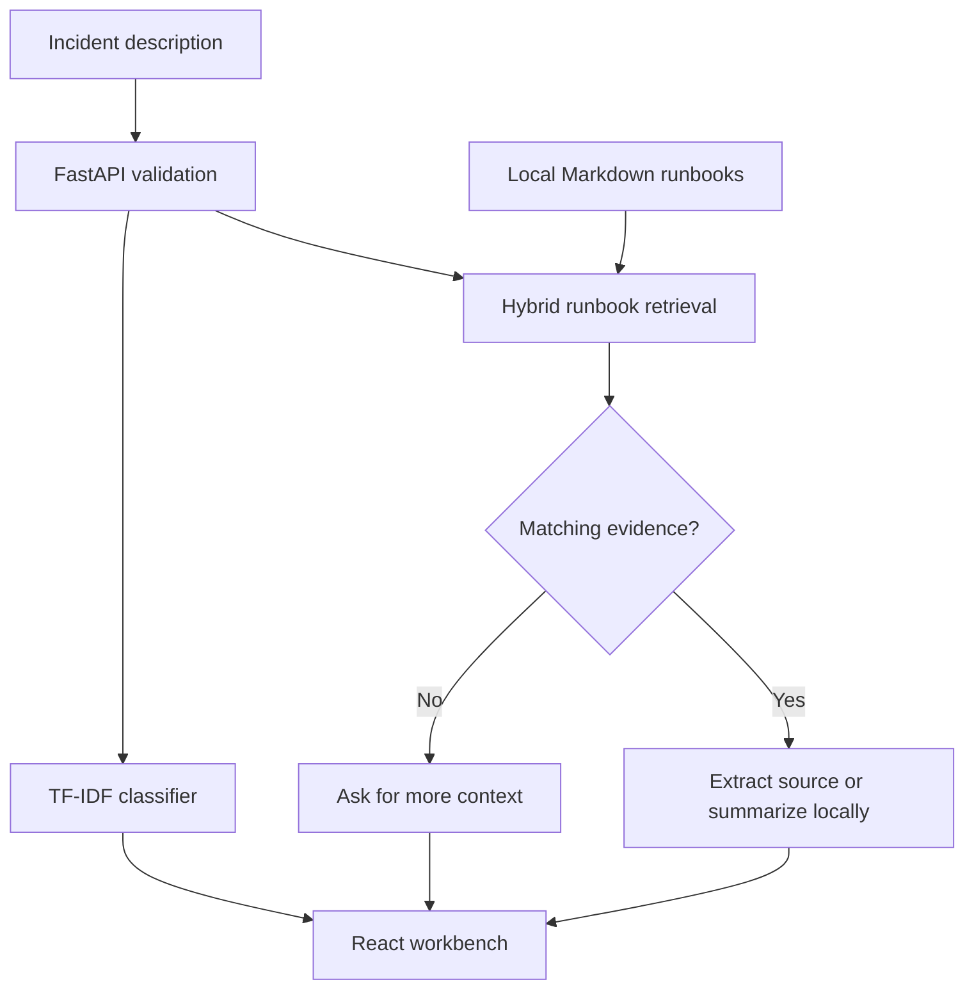

# RunbookOps

Route an incident description to a service area, retrieve relevant runbook passages,
and inspect the source lines behind each suggested investigation step.

RunbookOps is a local prototype built with Python, scikit-learn, FastAPI, and
React/TypeScript. Its default path uses a trained classifier and sparse retrieval;
local LLM synthesis is optional. The application never executes remediation.

**Status:** working baseline with passing Python tests and frontend build.
Evaluation uses 90 synthetic descriptions across 30 scenarios and 10 synthetic
runbooks, plus separate 20-query validation and holdout suites. Operational usefulness
has not been measured on real incidents.

For a code walkthrough, start with the [implementation map](docs/review-guide.md).
The [model card](docs/model-card.md) describes the evaluation protocol and its limits.

## Run locally

Requires Python 3.12 and Node.js 24 (the versions targeted by CI).

```sh
git clone https://github.com/harshaattili-human/runbookops.git
cd runbookops
python -m venv .venv
source .venv/bin/activate
# Windows PowerShell: .venv\Scripts\Activate.ps1
pip install -e '.[dev]'
python -m runbookops.evaluate
python -m runbookops.benchmark --split validation
python -m runbookops.answerability --split validation
python -m runbookops.passage_answerability --split validation
cd frontend
npm ci
npm test
npm run build
cd ..
python -m uvicorn runbookops.api:app --host 127.0.0.1 --port 8000
```

Open http://127.0.0.1:8000 for the workbench and http://127.0.0.1:8000/docs for
the API. For frontend development, run `npm run dev` in `frontend` with the API
running separately; Vite proxies `/api` to port 8000.

The editable install intentionally uses the checked-out `data/` and `reports/`
directories. For a non-editable package installation, set `RUNBOOKOPS_ROOT` to the
absolute checkout path. The Dockerfile sets this to `/app`.

## Try it

Choose **Connection pool**, inspect the routing signals, and open the referenced
source. Then compare **Missing information** (related document, insufficient coverage)
with **Outside the corpus** (no retrieved candidate). Source cards check the [document version](docs/review-guide.md#source-versions)
before opening it; if the indexed runbook changed, run the analysis again.
The **Evaluation** tab displays
measured results and misclassifications from the checked-in report.

For an interview walkthrough without running the backend, export the
[single-file recorded demo](docs/recorded-demo.md). CI checks it with networking
offline and provides a downloadable artifact; it replays five synthetic scenarios
and is clearly labeled as recorded, rather than accepting new incident text.

```sh
curl http://127.0.0.1:8000/api/triage \
  -H 'Content-Type: application/json' \
  -d '{"query":"Kafka consumer lag keeps rising and the group rebalances repeatedly."}'
```

## How it fits together

For a Java backend caller, the [Spring Boot example](docs/spring-client.md) preserves
abstention, checks source versions and distinguishes HTTP failures from valid results.
Its separate CI job calls the running Python API using synthetic incidents.



The classifier uses TF-IDF and logistic regression. Retrieval combines BM25 and
TF-IDF cosine similarity. Sparse retrieval was chosen to make the first baseline
fast, reproducible, and easy to inspect. Both indexes are built in memory from the
local Markdown files when the application starts.

Operators can select a manifest-pinned runbook release at startup using
`RUNBOOKOPS_CORPUS_RELEASE` and `RUNBOOKOPS_CORPUS_SHA256`; invalid releases prevent
startup instead of falling back to bundled files. Trusted Python integrations can
also refresh the index while requests retain their captured snapshots. See the
[refresh contract](docs/index-refresh.md).

## Evaluation and checks

The [browser checks](docs/browser-checks.md) exercise live triage, versioned source
inspection and keyboard navigation in Chromium, Firefox and WebKit at three viewport sizes. The report
includes reproducible screenshots; physical-device and assistive-technology checks
remain separate work.

```sh
python -m pytest -q
python -m runbookops.evaluate
python -m runbookops.benchmark --split validation
python -m runbookops.answerability --split validation
python -m runbookops.passage_answerability --split validation
cd frontend
npm test
```

The classifier scores approximately **0.945 macro F1**, versus **0.067** for a
most-frequent-label baseline on the same three scenario-grouped folds. The original
retrieval smoke set found 10/10 expected documents and abstained on 4/4 unrelated
questions. The additional validation and holdout suites exposed a gap: each returned
guidance for **6/10 unsupported requests**, despite finding the expected top document
for all ten supported requests. These are small synthetic experiments.

Read [the baseline comparison](docs/evaluation-v1.md) and the follow-up
[answerability experiment](docs/answerability-v2.md). An IDF-weighted document-coverage
gate reduced unsupported answers from 11/14 to 3/14 on a new frozen synthetic holdout,
while withholding one of 12 supported answers; another supported case still selected
the wrong top document. This tradeoff is not production accuracy. Routine CI scores
validation; holdout commands are explicit reproduction steps.

A follow-up [passage-coverage experiment](docs/passage-experiment.md) reduced
validation's unsupported answers from 1/10 to 0/10, but failed to improve the
already-exposed v2 regression cases and withheld two additional supported answers.
It remains an experiment; the service behavior did not change.

The [contrastive answerability experiment](docs/information-type-v3.md) uses 20
validation queries and 20 holdout queries, paired as documented guidance versus
missing-information requests. The fixed request-shape candidate preserved the
baseline's expected-top-and-answered supported count on both splits (9/10 validation,
8/10 holdout), while unsupported answers changed from 8/10 to 0/10 on validation and
6/10 to 1/10 on the once-scored holdout. It met the preregistered numeric rule, but
was not adopted: existing concurrency checks showed that a descriptive sentence
containing “maximum” was misread as a request for an exact value. The holdout is
exposed, and these same-author synthetic grammar patterns are neither entailment nor
production accuracy.

A new [v4 contrastive freeze](docs/information-type-v4.md) adds 20 validation and
20 holdout queries with fragmentary and statement-form phrasing. Integrity checks
score zero queries. A fixed request-target candidate then retained 9/10
expected-top-and-answered supported validation cases while reducing unsupported
answers from 8/10 to 0/10. The subsequent single holdout comparison preserved 10/10 supported answers and
changed unsupported answers from 9/10 to 5/10 (correct pairs 1/10 to 5/10). Five
failures remain in the full report. V4 is now exposed; the [unchanged candidate is applied before generation](docs/request-target-guard.md),
and no candidate repair is allowed from these results.

Read [the model card](docs/model-card.md) and inspect
[the complete evaluation](reports/evaluation.json), including failures and split
membership. [The first GitHub Actions run](https://github.com/harshaattili-human/runbookops/actions/runs/37152016110)
passed on October 3, 2026, including the Python tests, evaluation, and frontend
production build on Python 3.12 and Node.js 24.

## Optional local LLM

Start an Ollama instance and choose a model already available on that instance.
Set `OLLAMA_MODEL` to that exact model name before starting the API. Optionally set
`OLLAMA_BASE_URL`; its default is `http://127.0.0.1:11434`. Check **Use configured
local LLM** in the UI. No model is downloaded automatically and no cloud service is
called by default.

The triage API [limits request bodies](docs/request-bounds.md) to 32 KiB before
JSON parsing; the existing 2,000-character query validation still applies.
An [eight-request admission cap](docs/triage-admission.md) bounds concurrent triage
lifetimes through upload, analysis and response sending; excess work receives 503.

Generation requires citation IDs from the retrieved evidence and a completed
provider response. The [adapter boundary](docs/ollama-boundary.md) caps the JSON
envelope at 65,536 bytes and falls back to the original source extract on oversized,
incomplete or invalid replies. Controlled HTTP tests cover this behavior; a live
local-model quality evaluation and citation-entailment checks remain pending.
Two generation attempts may run concurrently per process; extra requests receive
the source extract with a busy warning instead of waiting for a provider slot.
A [30-second generation I/O deadline](docs/generation-deadline.md) also falls back
when a provider stalls or keeps sending an unfinished reply.
[Disconnected callers](docs/client-disconnect.md) cancel optional provider I/O
and release their generation slots. The adapter and its loopback/ASGI checks use
[HTTPX2](docs/httpx2-migration.md); the migration preserves these boundary policies.

## Container

```sh
docker build -t runbookops .
docker run --rm -p 127.0.0.1:8000:8000 runbookops
```

The image builds the frontend and runs the API as a non-root user. The separate
[container CI check](docs/container-checks.md) exercises the packaged UI and API,
read-only operation, health checks and restart behavior.
[Dependency audits](docs/dependency-audits.md) check the installed image and npm
lockfile; passing CI does not mean zero known vulnerabilities. Keep this demo local:
authentication, rate limiting, and multi-tenant isolation are not implemented.

## Project notes

- [Design decisions](docs/decisions.md)
- [Data provenance](data/README.md)
- [Two-minute demo and interview discussion](docs/demo-script.md)
- [Next improvements](docs/roadmap.md)
- [Contribution workflow](CONTRIBUTING.md)

## Provenance

Independent portfolio project by Harsha Attili, developed with AI coding assistance.
The code, incidents, and runbooks were created for this project; no employer code,
internal documents, or production logs are included. See [data provenance](data/README.md).

Implementation references: [scikit-learn pipelines](https://scikit-learn.org/stable/modules/compose.html),
[grouped splits](https://scikit-learn.org/stable/modules/generated/sklearn.model_selection.StratifiedGroupKFold.html),
[FastAPI static files](https://fastapi.tiangolo.com/tutorial/static-files/),
and [Ollama chat API](https://docs.ollama.com/api/chat).
